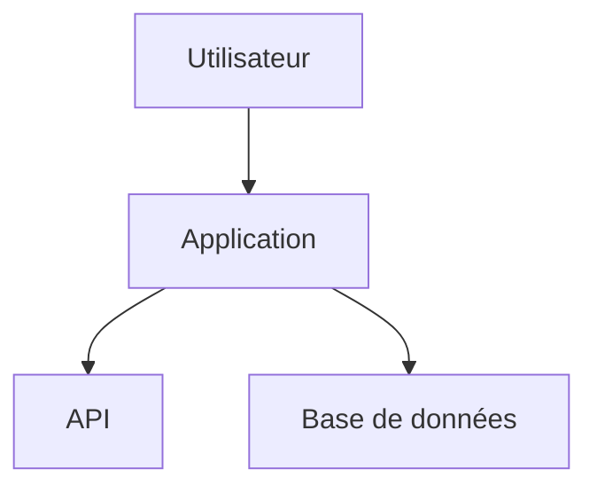

# Introduction

Ce document sert à valider la conversion d'un fichier Markdown vers PDF avec plusieurs moteurs :

- HTML + Chrome
- HTML + WeasyPrint
- LuaLaTeX (MiKTeX)

L'objectif est d'identifier les différences de rendu.

## Caractères spéciaux

Accents :

à â ä ç é è ê ë î ï ô ö ù û ü ÿ

Guillemets :

« français » et "anglais"

Tirets :

- simple
- moyen –
- long —

Symboles :

✓ ✗ ★ ☆ ☑ ☒

Flèches :

→ ← ↑ ↓ ⇒ ⇐ ⇔

Mathématiques Unicode :

≤ ≥ ≠ ± × ÷ ∞

---

# Titres

## Niveau 2

### Niveau 3

#### Niveau 4

##### Niveau 5

Texte normal.

Texte **gras**.

Texte *italique*.

Texte ***gras italique***.

Texte ~~barré~~.

Texte `inline code`.

---

# Paragraphes et citations

Lorem ipsum dolor sit amet, consectetur adipiscing elit. Sed non risus.

> Ceci est une citation.
>
> Sur plusieurs lignes.
>
> Auteur inconnu

---

# Listes

## Liste à puces

- Premier élément
- Deuxième élément
  - Sous élément A
  - Sous élément B
- Troisième élément

## Liste numérotée

1. Étape 1
2. Étape 2
3. Étape 3

## Liste de tâches

- [x] Terminé
- [ ] À faire

---

# Tableaux

## Tableau simple

| Colonne A | Colonne B | Colonne C |
|------------|------------|------------|
| Valeur 1 | Valeur 2 | Valeur 3 |
| Valeur 4 | Valeur 5 | Valeur 6 |

## Tableau large

| Produit | Quantité | Prix Unitaire | Montant |
|----------|----------:|--------------:|---------:|
| Article A | 5 | 12.50 | 62.50 |
| Article B | 17 | 4.95 | 84.15 |
| Article C | 100 | 1.25 | 125.00 |
| Total | | | 271.65 |

---

# Code source

## Python

```python
from pathlib import Path

def hello(name: str):
    print(f"Bonjour {name}")

hello("Pandoc")
```

## JSON

```json
{
  "application": "demo",
  "version": "1.0.0",
  "enabled": true
}
```

## XML

```xml
<customer id="123">
    <name>Jean Dupont</name>
</customer>
```

---

# Bloc préformaté

    Ligne 1
    Ligne 2
    Ligne 3

---

# Mathématiques

## Formule inline

La formule de Pythagore est : $a^2+b^2=c^2$.

## Formule centrée

$$
\int_{0}^{+\infty}
e^{-x}dx = 1
$$

## Matrice

$$
A=
\begin{bmatrix}
1 & 2\\
3 & 4
\end{bmatrix}
$$

---

# Notes de bas de page

Une phrase avec une note[^note1].

Une autre note[^note2].

[^note1]: Première note de bas de page.

[^note2]: Deuxième note plus longue permettant de vérifier le rendu.

---

# Liens

- Site de Pandoc : <https://pandoc.org>
- Site de WeasyPrint : <https://weasyprint.org>
- Site de MiKTeX : <https://miktex.org>

Lien Markdown :

[Pandoc](https://pandoc.org)

---

# Images

## Image distante


## Image locale


---

# Couleurs HTML

Cette section permet de vérifier le comportement des moteurs HTML.

<span style="color:red">Texte rouge</span>

<span style="color:blue">Texte bleu</span>

<span style="background-color:yellow">
Fond jaune
</span>

---

# HTML embarqué

<div style="border:2px solid black;padding:10px">

Contenu HTML encapsulé.

<ul>
<li>Élément 1</li>
<li>Élément 2</li>
</ul>

</div>

---

# Saut de page

\newpage

Cette page doit commencer après un saut de page.

---

# Diagramme Mermaid



---

# Long tableau

| N° | Désignation | Commentaire |
|----|-------------|-------------|
| 1 | Élément | Test |
| 2 | Élément | Test |
| 3 | Élément | Test |
| 4 | Élément | Test |
| 5 | Élément | Test |
| 6 | Élément | Test |
| 7 | Élément | Test |
| 8 | Élément | Test |
| 9 | Élément | Test |
| 10 | Élément | Test |
| 11 | Élément | Test |
| 12 | Élément | Test |
| 13 | Élément | Test |
| 14 | Élément | Test |
| 15 | Élément | Test |
| 16 | Élément | Test |
| 17 | Élément | Test |
| 18 | Élément | Test |
| 19 | Élément | Test |
| 20 | Élément | Test |

---

# Test de pagination

Lorem ipsum dolor sit amet, consectetur adipiscing elit.

Lorem ipsum dolor sit amet, consectetur adipiscing elit.

Lorem ipsum dolor sit amet, consectetur adipiscing elit.

Lorem ipsum dolor sit amet, consectetur adipiscing elit.

Lorem ipsum dolor sit amet, consectetur adipiscing elit.

Lorem ipsum dolor sit amet, consectetur adipiscing elit.

Lorem ipsum dolor sit amet, consectetur adipiscing elit.

Lorem ipsum dolor sit amet, consectetur adipiscing elit.

Lorem ipsum dolor sit amet, consectetur adipiscing elit.

Lorem ipsum dolor sit amet, consectetur adipiscing elit.

---

# Quelques symboles

$\rightarrow$

$\leftarrow$

$\checkmark$

---

# Emoticônes en unicode

🎯

🛠️

🏛️

🚀

📉

---

# Conclusion

Le document a permis de tester :

- la table des matières ;
- la numérotation ;
- les tableaux ;
- le code coloré ;
- les mathématiques ;
- les notes de bas de page ;
- les images ;
- le HTML embarqué ;
- les caractères Unicode ;
- les sauts de page ;
- la pagination PDF.

Fin du document.
